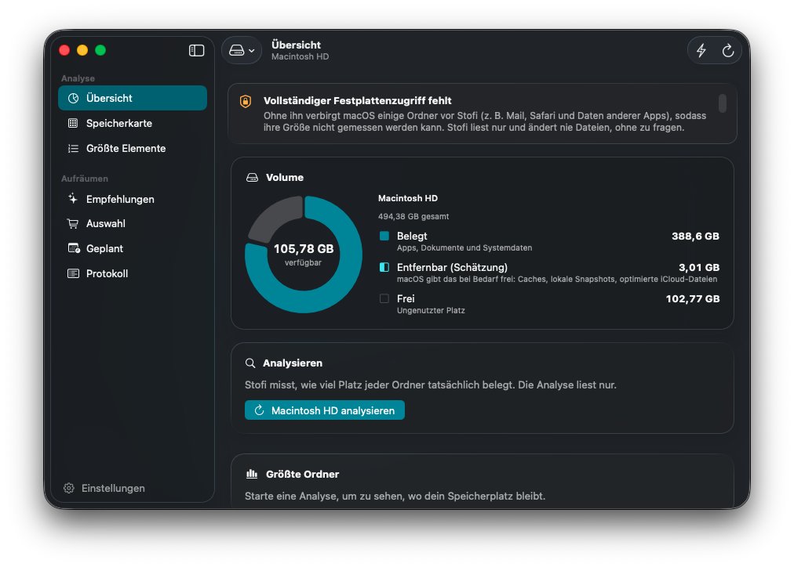
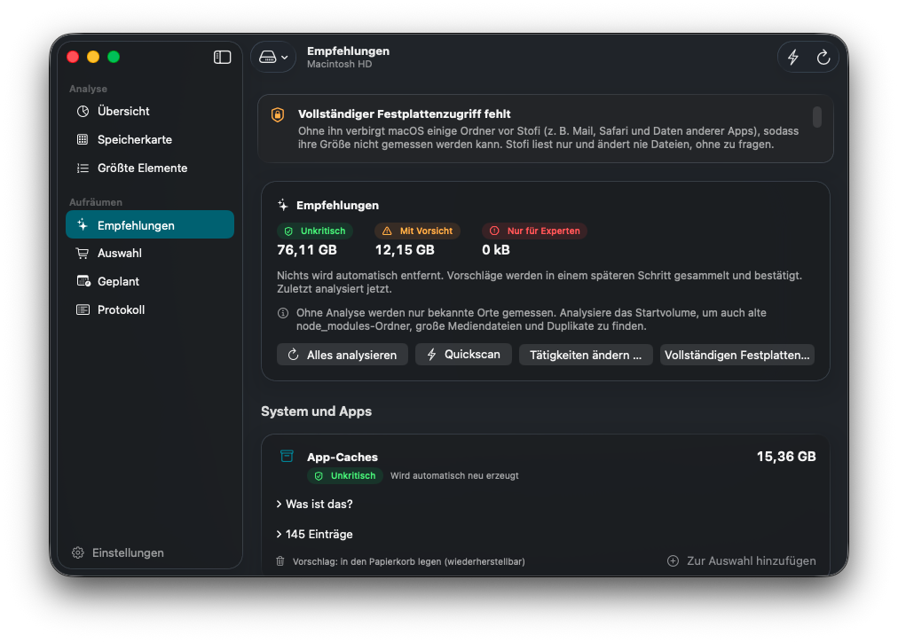
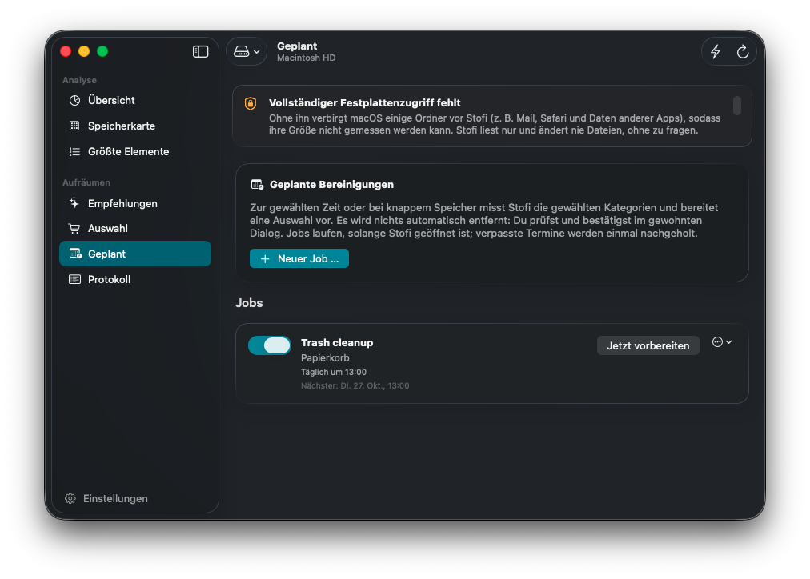
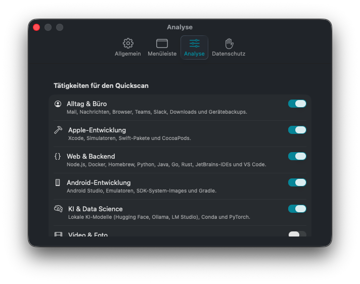

# Stofi – Storage Fighter

**See where your Mac's storage goes, and win it back safely.**

  [](LICENSE)

Stofi is a native macOS app that scans your disk in seconds, explains what takes up space and helps you clean up without risk. It suggests, you decide: nothing is ever removed without your confirmation.



## Why Stofi

- **Fast.** A parallel scanner built on `getattrlistbulk` reads around 180,000 files per second, with live results while it runs.
- **Honest numbers.** Stofi measures the space files really occupy on disk. Hard links are counted once, and APFS clones and snapshots are taken into account.
- **Safe by design.** The analysis only reads, and the default action is the Trash. A protection list guards system folders, iCloud, Photos, Mail, keychains and more. You can't switch it off.
- **Private.** No telemetry, no network access. Everything stays on your Mac.
- **Native.** SwiftUI with Liquid Glass on macOS 26, in English and German, with light and dark mode, VoiceOver and keyboard control.

## Features

### Understand your disk
- **Overview:** Capacity, used, free and removable space, plus storage categories such as apps, user data, developer data and caches.
- **Storage map:** A fast treemap to drill into folders.
- **Largest items:** Sortable and filterable by size, age and last opened.

### Clean up with confidence
- **Recommendations:** Caches, logs, old downloads, Xcode data, simulators, package caches, inactive `node_modules`, Docker, device backups, large media and duplicates. Each comes with its size, an explanation, a risk level and whether it comes back on its own.
- **One-click quickscan:** Tailored to what you do on your Mac: everyday & office, Apple development, web & backend, Android, AI & data science, video & photo, music & audio, and gaming.
- **Selection and confirmation:** Collect what you want to remove and review the exact list. Then move it to the Trash, or delete it permanently where the data can be recreated.
- **Scheduled clean-ups:** Stofi prepares a selection on a schedule or when space runs low, and asks you before anything happens.
- **Clean-up log:** Shows what was removed, when, and how much space it freed.

### Stay informed
- **Optional menu bar status:** Disk status at a glance, readable by shape, not only by colour.
- **Low-space notifications:** They only inform you and never act on their own.

<p align="center">
  
  
</p>
<p align="center">
  
</p>

<sub>Screenshots show the German interface.</sub>

## Safety first

Stofi follows a few non-negotiable rules:

1. Nothing is deleted without your explicit confirmation. There are no background clean-ups.
2. Scanning is strictly read-only.
3. The Trash is the default. Permanent deletion is only offered for data that can be recreated, and needs a second confirmation.
4. Every action shows the exact paths and commands first.
5. Tool commands (e.g. `xcrun simctl`, `brew cleanup`) come from a fixed allowlist, run without a shell, and show their output.

## Requirements

- macOS 26 Tahoe
- Xcode 26.6+ to build from source

## Build

```bash
git clone <repository-url>
```

```bash
open Stofi/Stofi.xcodeproj
```

Select your team under *Signing & Capabilities*, then run with ⌘R.

For complete results, grant Stofi **Full Disk Access** in *System Settings → Privacy & Security*. Without it, macOS hides some folders (Mail, Messages, other apps' data) from the analysis.

## Under the hood

Swift 6 with strict concurrency, SwiftUI, and no third-party dependencies. The core lives in a local Swift package (`Packages/StofiCore`):
- `ScannerKit`: the read-only scanner
- `LayoutKit`: the treemap layout
- `AnalysisKit`: the recommendations
- `CleanupKit`: the only module that can remove anything, and only through a confirmed plan

The package comes with 96 tests that run in temporary folders only:

```bash
cd Packages/StofiCore && swift test
```

## Known limitations

- Scan results are not stored. Each launch starts with a fresh scan.
- External and network volumes are not included in the startup-disk scan. You can scan them through *Choose Folder…*.
- The sizes of local Time Machine snapshots and of the system's “removable” space are estimates from macOS.

## License

Stofi is released under the [MIT License](LICENSE).
